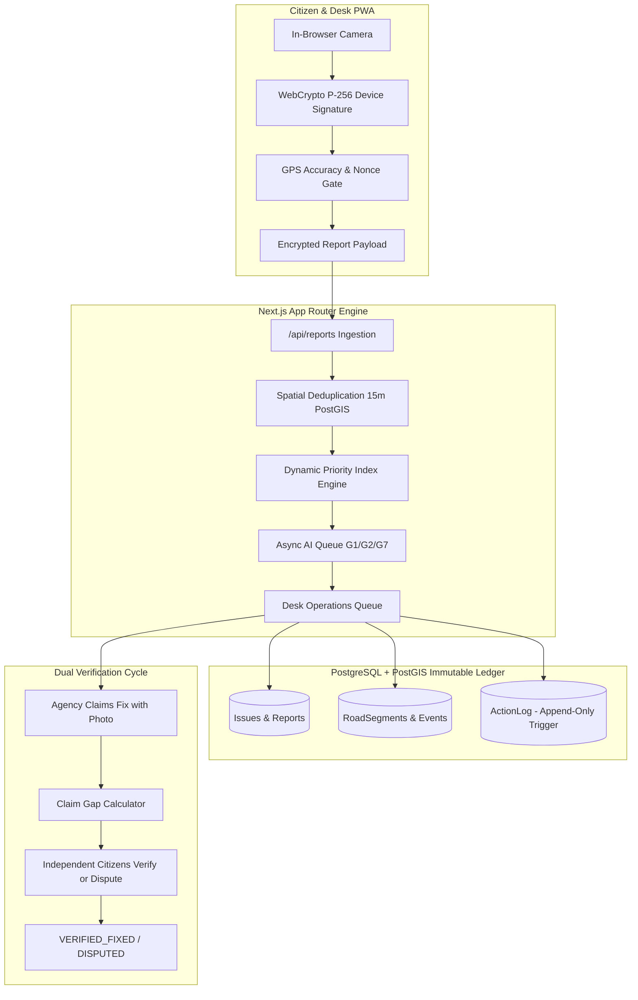

# CivicPulse — Bengaluru Municipal Road Truth Ledger

> An immutable civic infrastructure truth ledger connecting Bengaluru residents and municipal authorities through cryptographically signed evidence, spatial PostGIS deduplication, dual citizen fix verification, and AI-assisted triage guardrails.

CivicPulse eliminates the **"claim gap"** — the systemic municipal discrepancy between authorities claiming a road defect has been repaired and the physical reality on the street.

---

## 1. What is CivicPulse?

CivicPulse is a two-sided municipal accountability platform:
- **For Citizens:** A progressive web app (PWA) with in-browser ECDSA P-256 cryptographic hardware signing, strict GPS accuracy gating ($\le 15\text{ m}$), offline local report queues, safe route navigation around live road hazards, and citizen-led repair verification.
- **For Authorities & Desks:** A unified cross-agency operations desk serving Greater Bengaluru Authority (GBA), BWSSB, BESCOM, Bengaluru Traffic Police (BTP), BMRCL, and BDA with automated Priority Index (PI) scoring, agency handoff tracking, and immutable audit logs.



---

## 2. Core Capabilities

### Cryptographic Evidence Integrity
- **Device Key Registration:** WebCrypto ECDSA P-256 keypairs generated in IndexedDB on first load.
- **5-Minute Nonce Expiry:** Reports require an active server-issued cryptographic nonce preventing replay attacks.
- **Hardware GPS Gate:** Strict coordinate bounds checked against the Bengaluru Metropolitan Region ($12.70^\circ - 13.25^\circ\text{ N}$, $77.40^\circ - 77.85^\circ\text{ E}$) with $\le 15\text{ m}$ accuracy required.

### Spatial PostGIS Deduplication & Snapping
- **Deduplication Radius:** Reports within 15 metres of an open defect merge automatically into a shared `Issue`, bumping community confidence and confirmation counters without duplicating work orders.
- **Corridor Snapping:** Automatically snaps reported coordinates to OSM road segments along major arterial corridors (e.g., Outer Ring Road).

### Deterministic State Machine & Append-Only Audit Trail
- **Lifecyle:**
  $$\text{OPEN} \longrightarrow \text{CONFIRMED} \longrightarrow \text{ASSIGNED} \longrightarrow \text{IN\_PROGRESS} \longrightarrow \text{CLAIMED\_FIXED} \longrightarrow \text{VERIFIED\_FIXED}$$
  Disputed repairs transition to $\text{DISPUTED}$ and trigger an automatic SLA escalation.
- **PostgreSQL Database Trigger:** All status transitions, agency handoffs, and desk actions record rows in `ActionLog`. An immutable database trigger strictly forbids `UPDATE` and `DELETE` operations on `ActionLog`.

### Multi-Model AI Provider Chain & Guardrails
- **Chain Architecture:** Primary Google Gemini $\rightarrow$ Secondary Groq $\rightarrow$ Local Ollama fallback.
- **Strict Guardrails:**
  - AI outputs **never** mutate the state machine directly or alter reporter defect categories.
  - Category discrepancies flag `needsDuplicateReview = true` for manual desk review.
  - Explainers enforce verbatim numbers grounded in input facts (`numbersGrounded`); any hallucinated metric falls back immediately to deterministic sentence templates.
- **Auditing & Quotas:** Every AI execution is hashed (`inputHash`), cached, and logged to `AiRun` with daily budget caps (default: 400 calls/day).

---

## 3. Technology Stack

| Layer | Technology |
| :--- | :--- |
| **Framework** | Next.js 16 (App Router with Server Actions & Route Handlers) |
| **Frontend UI** | React 19, Tailwind CSS v4, Lucide React, Framer Motion, Sonner |
| **Mapping** | Leaflet, React-Leaflet, OpenStreetMap Carto tiles |
| **Database** | PostgreSQL 16+ with PostGIS spatial extensions |
| **ORM & Client** | Prisma ORM with `@prisma/adapter-pg` connection pooler |
| **Authentication** | NextAuth.js v4 (Credentials + Role-based Citizen/Authority access) |
| **Cryptography** | WebCrypto API (ECDSA P-256 public JWK signing & SHA-256 evidence hashing) |
| **AI Chain** | Gemini API (`gemini-2.5-flash`), Groq (`qwen3.8-27b`), Ollama fallback |
| **Testing** | Vitest (Unit & Contract tests), Playwright (End-to-End browser tests) |
| **PWA** | Web Manifest, Service Worker (`public/sw.js`), Offline Shell |

---

## 4. Getting Started

### Prerequisites
- Node.js 20+ and npm
- PostgreSQL 16+ with the `postgis` extension enabled
- Environment file (`.env` and `.env.local`)

### Installation & Database Setup

1. **Clone and install dependencies:**
   ```bash
   git clone https://github.com/your-org/civicpulse.git
   cd civicpulse/miniproject
   npm install
   ```

2. **Configure environment:**
   Create a `.env.local` file (see the [Environment Variables](#5-environment-variables) table below).

3. **Run database migrations and seed:**
   ```bash
   npx prisma migrate deploy
   npm run db:seed
   ```

4. **Start the local development server:**
   ```bash
   npm run dev
   ```
   Open [http://localhost:3000](http://localhost:3000) in your browser.

---

## 5. Environment Variables

CivicPulse operates in **Keys-Later Mode** (`docs/plan/KEYS_LATER.md`): any external API without an active key gracefully falls back to synthetic fixtures or displays `"disabled — key not set"` without breaking core application functionality.

| Variable | Required? | Default | Description |
| :--- | :--- | :--- | :--- |
| `NODE_ENV` | Optional | `development` | Node environment (`development`, `test`, `production`). |
| `APP_DATABASE_URL` | **Required** | - | PostgreSQL connection URL with pooled connection for app queries. |
| `DIRECT_DATABASE_URL` | Optional | - | Direct PostgreSQL connection URL for Prisma migrations. |
| `NEXTAUTH_URL` | **Required** | `http://localhost:3000` | Canonical root URL of the application. |
| `NEXTAUTH_SECRET` | **Required** | - | Cryptographic secret for signing session JWT tokens. |
| `SEED_DESK_PASSWORD` | Optional | - | Baseline password used by `npm run db:seed` for seeded desk officers. |
| `SUPABASE_URL` | Optional | - | Supabase project URL for remote PostgreSQL / storage. |
| `SUPABASE_SERVICE_ROLE_KEY` | Optional | - | Supabase service role key for administrative storage tasks. |
| `SUPABASE_EVIDENCE_BUCKET` | Optional | `evidence` | S3-compatible evidence storage bucket name. |
| `TOMTOM_API_KEY` | Optional | - | TomTom API key for routing & traffic. When unset, routing falls back to synthetic safe routes. |
| `GEMINI_API_KEY` | Optional | - | Google Gemini API key for photo triage (G1) and sentence explainers (G7). |
| `GEMINI_MODEL` | Optional | `gemini-2.5-flash` | Gemini model name used in the primary provider chain. |
| `GROQ_API_KEY` | Optional | - | Groq API key for vision comparisons (G2) and text backup. |
| `GROQ_MODEL_VISION` | Optional | `qwen/qwen3.8-27b` | Groq vision model identifier. |
| `GROQ_MODEL_TEXT` | Optional | `openai/gpt-oss-120b` | Groq text model identifier. |
| `AI_DAILY_CALL_CAP` | Optional | `400` | Maximum combined external LLM calls per day across all users. |
| `AI_FEATURES` | Optional | `G1,G2,G7` | Comma-separated list of active AI features. |
| `REDDIT_CLIENT_ID` | Optional | - | Reddit API client ID for social civic signal radar (G5). |
| `REDDIT_CLIENT_SECRET` | Optional | - | Reddit API client secret. |
| `REDDIT_USER_AGENT` | Optional | - | Reddit API user agent string. |
| `APP_REGION` | Optional | `IN` | Operating country code (defaults to India). |
| `VAPID_PRIVATE_KEY` | Optional | - | VAPID private key for web push notifications. |
| `VAPID_SUBJECT` | Optional | `mailto:you@example.com` | Contact email associated with VAPID web push. |
| `JOB_SECRET` | Optional | - | Secret bearer token required to invoke scheduled `/api/jobs/*` cron endpoints. |
| `APP_TIMEZONE` | Optional | `Asia/Kolkata` | Local timezone for SLA calculations and timestamps. |

---

## 6. Testing & Quality Gate

Every task and pull request must strictly pass the full quality gate (Rule 7):

```bash
# 1. Static Analysis & Linting
npm run lint

# 2. Strict TypeScript Compilation
npm run typecheck

# 3. Unit & Contract Test Suite (34+ suites, 190+ tests)
npm test

# 4. Production Webpack Build
npm run build

# 5. Playwright End-to-End Suite
npm run e2e
```

---

## 7. Data Sources & Attributions

CivicPulse is built upon open municipal data and civic services:
- **OpenStreetMap (OSM):** Road networks and geometry extracted via the Overpass API under the Open Database License (ODbL).
- **Open-Meteo:** Meteorological historical and forecast rainfall data for road flood memory.
- **TomTom Maps:** Routing algorithms and real-time traffic flow index (fallback to synthetic routing when key not configured).
- **OpenCity Bengaluru:** Greater Bengaluru Authority (GBA) ward boundary polygon datasets.
- **DULT Karnataka:** Bengaluru Metropolitan Transport Corporation (BMTC) public GTFS transit feeds.

---

## 8. Municipal Public Record & Non-Commercial Notice

CivicPulse is an independent, non-commercial civic technology initiative designed to enhance municipal accountability, road safety, and citizen-authority collaboration across Greater Bengaluru. All public truth ledger entries and inspection histories are cryptographically verifiable records.
